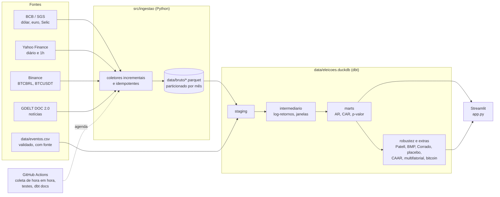

# Eleições × mercado brasileiro — estudo de evento (2014–2026)

[](https://github.com/ArthurDavila879/eleicoes-mercado/actions/workflows/testes.yml)
[](https://github.com/ArthurDavila879/eleicoes-mercado/actions/workflows/coleta.yml)
[](https://arthurdavila879.github.io/eleicoes-mercado/)


Engenharia e análise de dados que mede **como o mercado brasileiro reage às eleições
presidenciais**: Ibovespa, ações e o real, do 1º turno de 2014 ao 2º turno de 2026. A coleta é
automática (GitHub Actions), as transformações e os testes estatísticos ficam em dbt-duckdb e
os resultados aparecem num dashboard Streamlit. O projeto é neutro: mede a reação de preços, não
avalia candidatos, e aplica a mesma metodologia a todos os eventos.

> ⚠️ **Não é recomendação de investimento.** Os resultados são descritivos: um retorno anormal
> mostra que o preço se moveu de forma incomum em volta do evento, não que o evento causou o
> movimento.

## Em poucas palavras

- **O que é:** um estudo que olha o que acontece com a Bolsa, as ações e o dólar logo depois de
  cada eleição presidencial no Brasil (2014, 2018, 2022 e 2026).
- **Como:** para cada ativo, uma conta estima quanto ele "normalmente" teria variado naqueles
  dias, a partir do comportamento nos meses anteriores e do resto do mercado. A diferença entre o
  que aconteceu e o normal é a **reação à eleição**. Testes estatísticos dizem se essa diferença
  é grande demais para ser acaso.
- **O que se viu:**
  - depois das 7 eleições com dados, o real sempre se valorizou mais que as moedas de outros
    países emergentes;
  - a Bolsa subiu mais que o normal depois de todos os 1º turnos;
  - em 2026 o bitcoin negociado em reais já mostrava a alta do real no domingo à noite, antes de
    o mercado abrir.
- **O que não se pode dizer:** que a eleição *causou* o movimento, nem qual candidato o mercado
  "prefere". O estudo mede preços, não avalia candidatos.
- **Onde ver:** no dashboard (imagem abaixo), que atualiza sozinho com os dados coletados de
  hora em hora.

## Principais achados

- **O real se valorizou contra outras moedas emergentes nas 7 eleições** com dados desde 2014.
  O retorno anormal médio (CAAR) foi de −3,2% no USD/BRL, com p < 0,01.
- **O Ibovespa subiu além do esperado nos 4 primeiros turnos** analisados (média de +6,3%). No 1º
  turno de 2026, foram +10,7% em cinco pregões (p < 0,0001), um resultado que se mantém no placebo
  com 200 datas sem eleição e no ajuste para comparações múltiplas.
- **O dólar implícito no bitcoin (BTCBRL ÷ BTCUSDT) captou a reação ainda no domingo.** Caiu 1,6%
  até a meia-noite e 4,4% até a abertura de segunda, praticamente o mesmo que o câmbio oficial no
  fim de semana (−4,3%).
- **O petróleo explica metade do retorno "anormal" da Petrobras em 2026.** O retorno vai de +7,4%
  no modelo de mercado simples para +3,9% (não significativo) quando o Brent entra no modelo.
- **O plano de análise do 2º turno de 2026 foi pré-registrado antes da votação**
  ([`PRE_REGISTRO.md`](PRE_REGISTRO.md), tag `pre-registro-2turno`).


**Links:** [resultados completos](docs/RESULTADOS.md) ·
[metodologia detalhada](docs/METODOLOGIA.md) ·
[documentação dbt e grafo de linhagem](https://arthurdavila879.github.io/eleicoes-mercado/) ·
[pré-registro](PRE_REGISTRO.md) · [decisões de projeto](DECISOES.md) ·
[deploy e operação](docs/OPERACAO.md)

## Pergunta

Os preços de ativos brasileiros (Ibovespa, ações e o real) têm **retornos anormais**
estatisticamente significativos em volta da divulgação dos resultados do 1º e do 2º turno, depois
de descontado o que seria esperado pelo comportamento do mercado (ou, no caso do real, de outras
moedas emergentes no mesmo período)?

## Arquitetura



Os Parquet versionados no git são a fonte da verdade; o DuckDB é reconstruído a partir deles
(também pelo próprio dashboard, quando os dados mudam). As transformações são modelos dbt em SQL,
mais modelos Python para os testes estatísticos, que importam `src/estatistica`.

| Fonte | O quê |
|---|---|
| [BCB / SGS](https://dadosabertos.bcb.gov.br/) | dólar e euro (venda), meta Selic |
| [Yahoo Finance](https://finance.yahoo.com/) | Ibovespa, 13 ações, USD/BRL e 4 moedas emergentes de controle, ETF `EEM`, Brent, minério, DXY, VIX, Treasury 10 anos, BTC-USD — diário desde 2014 e 1h nos últimos ~2 anos |
| [Binance](https://developers.binance.com/docs/binance-spot-api-docs/rest-api/market-data-endpoints) | BTCBRL e BTCUSDT de hora em hora, 24 h por dia (dólar implícito no fim de semana) |
| [GDELT DOC 2.0](https://blog.gdeltproject.org/gdelt-doc-2-0-api-debuts/) | volume e tom de notícias por candidato (a mesma consulta para todos; só descritivo) |
| `data/eventos.csv` | 1º e 2º turnos de 2014, 2018, 2022 e 2026, com hora oficial e fonte (TSE, Câmara, Senado) |

## Metodologia

**Estudo de evento** clássico (MacKinlay, 1997):

| | Diária | Horária (só 2026) |
|---|---|---|
| Dia/barra 0 | 1º pregão após o evento (eleições são domingo à noite → segunda-feira) | 1ª barra de 1h a partir do evento |
| Janela do evento | **[-1, +3] pregões** | **[-2h, +6h]** |
| Janela de estimação | [-120, -11] pregões | [-300, -11] barras |

- **Retorno normal:**
  - ações: modelo de mercado contra o Ibovespa;
  - Ibovespa: contra o ETF de emergentes `EEM`;
  - real: contra a média de MXN, CLP, COP e ZAR.
- **Retorno anormal (AR)** = observado − normal. **CAR** = soma dos AR na janela, com
  `t = CAR / (σ̂·√L)` e p-valor bicaudal pela t de Student.
- **Robustez:** Patell, BMP, Corrado, placebo com datas sem evento, sensibilidade de janela e
  ajuste de Holm.
- **Análises adicionais:**
  - eleições de 2014–2022 e análise agregada entre eleições (CAAR, e um qui-quadrado que detecta
    reação em qualquer direção);
  - modelo multifatorial com Brent e minério;
  - carteiras long-short de estatal − privada;
  - volatilidade e volume anormais;
  - dólar implícito no bitcoin.

  Detalhes e fórmulas em [`docs/METODOLOGIA.md`](docs/METODOLOGIA.md).
- **Validação:**
  - cada teste estatístico tem testes com dados sintéticos, um caso sem choque (não pode dar
    significativo) e um com choque conhecido (precisa detectar);
  - um teste do dbt confere que a reimplementação em Python reproduz exatamente o CAR e o
    p-valor dos modelos SQL.

## Limitações

- **Poucos eventos:** 7 eleições com dados (8 com o 2º turno de 2026); cada uma também é um
  estudo de caso.
- **Eventos sobrepostos:** notícias e choques globais nos mesmos dias; os controles reduzem, mas
  não eliminam, a contaminação.
- **Fim de semana:** a reação aparece no pregão de segunda e mistura tudo o que aconteceu desde
  domingo.
- **Dados:**
  - barras de 1h só existem nos últimos ~2 anos;
  - o par BTCBRL tem pouca liquidez;
  - a série do minério de ferro é fraca;
  - o GDELT quase não registrou notícias brasileiras em volta do 1º turno de 2026;
  - a fonte do Tesouro Direto estava indisponível, então os juros ficaram fora.

Lista completa em [`docs/METODOLOGIA.md`](docs/METODOLOGIA.md) e decisões em [`DECISOES.md`](DECISOES.md).

## Como rodar

```bash
python -m venv .venv && source .venv/bin/activate   # Windows: .venv\Scripts\activate
pip install -r requirements-dev.txt

pytest -q                            # testes (sem rede)
python -m src.pipeline --sem-coleta  # carga dos Parquet versionados + dbt build
streamlit run app.py                 # dashboard em http://localhost:8501
```

`python -m src.pipeline` (sem `--sem-coleta`) também coleta dados novos. Com Docker:

```bash
docker compose up -d --build app     # dashboard em http://localhost:8501 (refaça o --build quando o código mudar)
docker compose --profile pipeline run --rm pipeline
```

Deploy no Streamlit Community Cloud, documentação no GitHub Pages, coleta automática e
monitoramento: [`docs/OPERACAO.md`](docs/OPERACAO.md).

## Estrutura

```
├── app.py                 # dashboard Streamlit (11 telas; ?tela=<nome> abre direto numa tela)
├── data/
│   ├── bruto/<fonte>/AAAA-MM.parquet
│   └── eventos.csv
├── dbt/                   # staging → intermediario → marts (SQL + modelos Python)
├── src/
│   ├── ingestao/          # coletores: bcb, yahoo, binance, gdelt; armazenamento e carga
│   ├── estatistica/       # estudo de evento, robustez, agregado, multifatorial, bitcoin
│   ├── eventos/           # validação de data/eventos.csv
│   ├── banco.py           # reconstrução automática do DuckDB pelo dashboard
│   └── pipeline.py
├── tests/                 # pytest: mocks, dados sintéticos e integração com o dbt
├── docs/                  # RESULTADOS.md, METODOLOGIA.md, OPERACAO.md, dashboard.png
├── .github/workflows/     # coleta.yml, testes.yml, docs.yml
├── PRE_REGISTRO.md        # plano do 2º turno, fixado antes da votação
└── DECISOES.md            # decisões de projeto e justificativas
```
