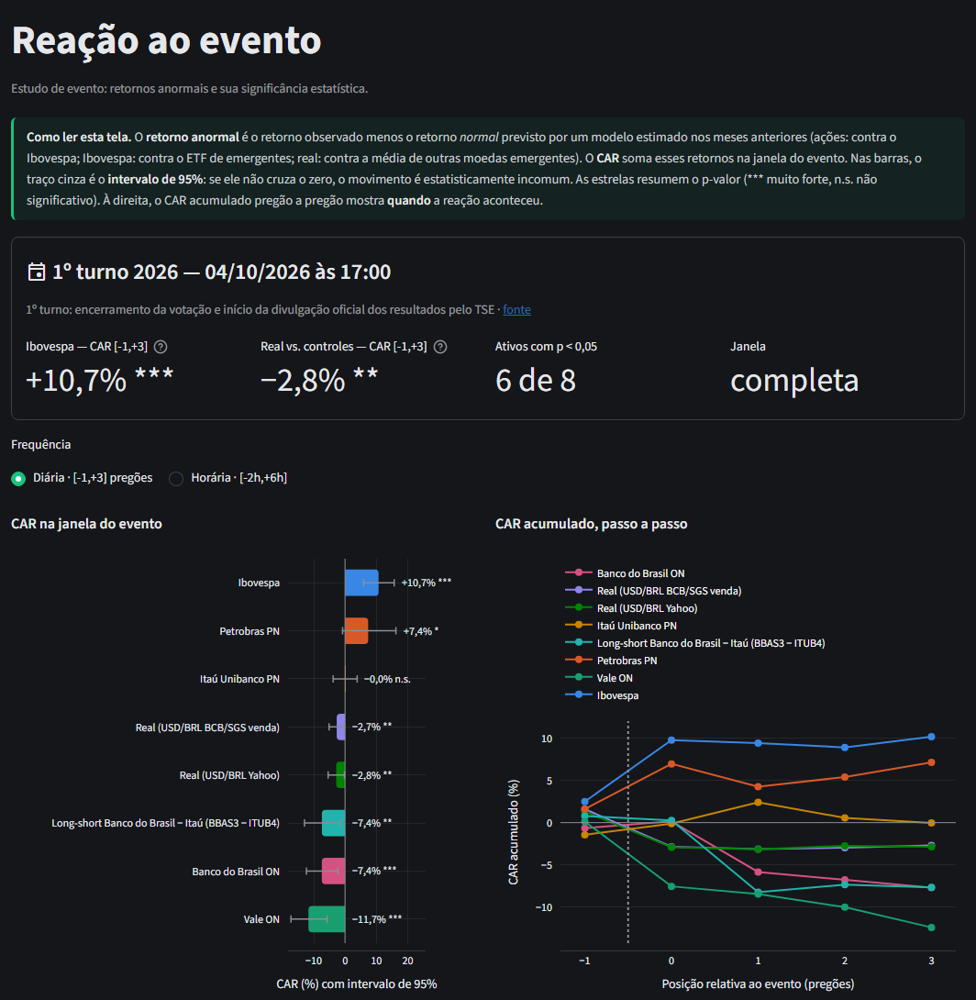
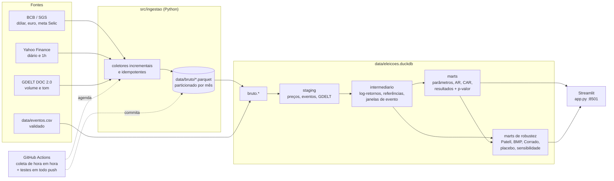

# Eleições 2026 × mercado brasileiro — estudo de evento

[](https://github.com/ArthurDavila879/eleicoes-mercado/actions/workflows/testes.yml)
[](https://github.com/ArthurDavila879/eleicoes-mercado/actions/workflows/coleta.yml)
[](https://arthurdavila879.github.io/eleicoes-mercado/)


> Engenharia + análise de dados que mede **como o mercado brasileiro reage a eventos das
> eleições de 2026**. O projeto é neutro: mede a reação de preços, não avalia candidatos, e
> aplica a mesma metodologia a todos os eventos e a mesma consulta de notícias a cada candidato.
>
> ⚠️ **Não é recomendação de investimento.**

<!-- Screenshot do dashboard: salve a imagem em docs/dashboard.png e descomente a linha abaixo.

-->

**Links:** dashboard (Streamlit Community Cloud — ver [Deploy](#deploy-do-dashboard-streamlit-community-cloud)) ·
[documentação dbt e grafo de linhagem](https://arthurdavila879.github.io/eleicoes-mercado/) ·
[pré-registro do 2º turno](PRE_REGISTRO.md) · [decisões de projeto](DECISOES.md)

## Pergunta

Os preços de ativos brasileiros (Ibovespa, ações de grande peso e o real) apresentam
**retornos anormais** estatisticamente significativos em torno de eventos eleitorais
— como a divulgação dos resultados do 1º e do 2º turno — depois de descontado o que
seria esperado pelo comportamento do mercado (ou, no caso do real, de outras moedas
emergentes no mesmo período)?

## Arquitetura



As transformações `staging → intermediario → marts` são modelos **dbt-duckdb** (SQL + modelos
Python para o p-valor e para os testes de robustez, que importam `src/estatistica`). Os Parquet versionados no git são a fonte da verdade; o
DuckDB é reconstruído a partir deles a cada execução.

## Fontes

| Fonte | O quê | Frequência | Observações |
|---|---|---|---|
| [BCB / SGS](https://dadosabertos.bcb.gov.br/) | Dólar venda (série 1), euro venda (21619), meta Selic (432) | diária | códigos confirmados no catálogo de dados abertos do BCB |
| [Yahoo Finance](https://finance.yahoo.com/) via `yfinance` | `^BVSP`, `PETR4.SA`, `VALE3.SA`, `ITUB4.SA`, `BBAS3.SA`, `PRIO3.SA` (só na carteira long-short), `BRL=X`, controles `MXN=X`, `CLP=X`, `COP=X`, `ZAR=X` e mercado global `EEM` (só diário) | diária e 1h | horários em UTC; ações diárias ajustadas por proventos |
| [Yahoo Finance](https://finance.yahoo.com/) — ampliação | ações `PETR3`, `BBDC4`, `AXIA3` (Eletrobras, ex-`ELET3`), `SBSP3`, `CMIG4`, `MRVE3`, `COGN3`, `MGLU3`; fatores globais `BZ=F` (Brent), `TIO=F` (minério de ferro), `DX-Y.NYB`, `^VIX`, `^TNX` (só diário); `BTC-USD` | diária e 1h | os fatores entram nos modelos multifatoriais ou como contexto; não têm CAR próprio |
| [Binance](https://developers.binance.com/docs/binance-spot-api-docs/rest-api/market-data-endpoints) (dados públicos) | `BTCBRL` e `BTCUSDT` | 1h, 24 h por dia | dólar implícito nos fins de semana; o Yahoo não tem BTC-BRL |
| [GDELT DOC 2.0](https://blog.gdeltproject.org/gdelt-doc-2-0-api-debuts/) | nº de artigos e tom médio por dia | diária | mesma consulta-base para cada candidato do 2º turno |
| `data/eventos.csv` | eventos com data/hora, tipo, descrição e fonte | — | só eventos com data certa e verificável |

Período: preços diários (Yahoo e BCB) desde 01/01/2014, para incluir as eleições de 2014, 2018 e
2022; barras de 1h dos últimos ~720 dias (limite do Yahoo); Binance desde nov/2020. O placebo usa
só a série a partir de 01/01/2023, como no pré-registro. A
coleta é incremental (cada execução só baixa o que falta, com uma pequena sobreposição para
corrigir barras parciais) e completa sozinha o histórico que faltar antes do 1º registro.

## Metodologia

**Estudo de evento** clássico (MacKinlay, 1997), em duas frequências:

| | Diária | Horária |
|---|---|---|
| Retorno | log-retorno fechamento a fechamento | log-retorno barra a barra (1h) |
| Dia/barra 0 | 1º pregão na data do evento; se o evento é a partir das 17h (Brasília) ou fora de pregão, o pregão seguinte | 1ª barra que começa no instante do evento ou depois |
| Janela do evento | **[-1, +3] pregões** | **[-2h, +6h]** (barras -2…+5) |
| Janela de estimação | [-120, -11] pregões (mín. 60) | [-300, -11] barras (mín. 150) |

**Retorno normal / anormal (AR)**

- **Ações** (PETR4, VALE3, ITUB4, BBAS3): modelo de mercado `R = α + β·R_Ibov + ε`, estimado
  por MQO na janela de estimação; `AR = R − (α̂ + β̂·R_Ibov)`.
- **Ibovespa:** modelo de mercado global `R = α + β·R_EEM + ε` na análise diária, com o ETF
  iShares MSCI Emerging Markets (`EEM`, NYSE) como mercado; o retorno do EEM é medido entre os
  mesmos dois pregões do Ibovespa (feriados só de um país não desalinham as datas). Na análise
  horária, média constante (`AR = R − média`): as barras de 1h dos EUA começam na meia hora e
  não se alinham às da B3.
- **Real** (`BRL=X` e o dólar do BCB): `AR = R_BRL − média(R_MXN, R_CLP, R_COP, R_ZAR)`, ou seja,
  quanto o real se moveu além do que outras moedas emergentes se moveram no mesmo dia/hora.
- **Carteiras long-short de mesmo setor** (estatal − privada): `r = r_BBAS3 − r_ITUB4` e
  `r = r_PETR4 − r_PRIO3`, calculadas como o log-retorno da razão de preços nos pregões/barras com
  as duas cotações, e tratadas como mais um ativo, com modelo de mercado contra o Ibovespa.
- **Mais ações** (exploratório, mesmo modelo de mercado): Petrobras ON, Bradesco, Eletrobras
  (`AXIA3`), Sabesp, Cemig, MRV, Cogna e Magazine Luiza; e o **spread Petrobras ON − PN**
  (`PETR3 − PETR4`), tratado como carteira.
- **Modelo multifatorial adicional** (diário), sem substituir o simples:
  `R = α + β_m·R_Ibov + β_f·R_fator`. Usa o Brent (`BZ=F`) para PETR4 e PETR3 e o minério de
  ferro (`TIO=F`) para a VALE3. O retorno do fator é medido entre os mesmos pregões da ação, e
  σ² usa n − 3 graus de liberdade. Os resultados aparecem lado a lado com o modelo de mercado
  (`fct_modelo_multifatorial`).
- Observações da janela de estimação que caem na janela de **outro** evento são descartadas.

**CAR e significância:** `CAR = Σ AR` na janela; `t = CAR / (σ̂·√L)`, com σ̂ estimado na janela
de estimação e L o nº de retornos na janela; p-valor bicaudal pela t de Student com os graus
de liberdade da estimação. A validade do procedimento é testada com dados sintéticos com um
choque conhecido injetado (`tests/test_dbt_integracao.py`).

### Robustez

Calculada para cada evento × ativo × frequência, com os mesmos parâmetros e a mesma estimação
do teste principal (fixados em [`PRE_REGISTRO.md`](PRE_REGISTRO.md) antes do 2º turno). Os
cálculos ficam em `src/estatistica/` e rodam em modelos Python do dbt; um teste do dbt confere
que a reimplementação reproduz exatamente o CAR, o t e o p-valor dos modelos SQL.

| Teste | O que faz | Mart |
|---|---|---|
| **Patell** | AR padronizado com correção do erro de previsão do modelo (`C_t = 1 + 1/T + (Rm_t − R̄m)²/Σ(Rm − R̄m)²`); Z normal | `fct_testes_robustez` |
| **BMP** | robusto a aumento de variância no evento; como há um ativo por evento, usa a dispersão dos SAR **dentro da janela** (t com L−1 gl; só com L ≥ 3, pouco poder com L = 5) | `fct_testes_robustez` |
| **Corrado** | não paramétrico: postos dos AR na amostra estimação + janela | `fct_testes_robustez` |
| **Holm** | ajuste para as 6 comparações da família principal (janela diária de Ibovespa, PETR4, VALE3, ITUB4, BBAS3 e `BRL=X`) | `fct_testes_robustez` |
| **Placebo** | a mesma metodologia em até 1000 datas sem evento por ativo (sem reposição, semente 20261025), fora das janelas reais; p-valor empírico `(1 + #{\|CAR_placebo\| ≥ \|CAR_real\|}) / (1 + n)`. Versão principal: pseudodia 0 no 1º pregão após um dia sem pregão (ou na 1ª barra do pregão), como num evento de domingo; versão "qualquer dia" como sensibilidade | `fct_placebo_distribuicao`, `fct_placebo_resultados` |
| **Sensibilidade de janela** | CAR e p-valor (t principal) em [0,0], [0,+1], [-1,+3] (principal) e [-5,+5] pregões | `fct_sensibilidade_janelas` |

### Eleições anteriores e análise agregada (só diária)

`data/eventos.csv` traz também o 1º e o 2º turno de **2014, 2018 e 2022**, com a mesma
metodologia diária: mesmo modelo de cada ativo, janela [-1,+3] e estimação [-120,-11]. Não há
análise horária nesses anos, porque não existem barras de 1h tão antigas
(`inicio_analise_horaria`). A hora de cada evento é a do início da divulgação oficial:

- **2014 e 2018:** a divulgação para presidente só começava quando a votação terminava no Acre
  (17h locais): 19h de Brasília, ou 20h no 2º turno de 2014, com Brasília em horário de verão;
- **2022:** horário unificado, com a votação terminando às 17h de Brasília.

As fontes estão no CSV (Agência Câmara, Rádio Senado, TSE). Como todos os eventos são num
domingo à noite, o dia 0 é sempre a segunda-feira seguinte.

A análise agregada (`fct_caar_eventos`) junta os eventos de cada ativo (todos, só 1º turnos, só
2º turnos):

- **CAAR**: média dos CAR;
- **t agregado**: `Σ CAR / √Σ ep²`, com as variâncias da estimação;
- **t transversal**: média sobre o erro-padrão entre eventos, com N − 1 gl;
- **qui-quadrado sem direção**: `Σ t²`, com N gl.

O último teste é o mais neutro: eleições diferentes podem mover o preço em sentidos opostos e a
média com sinal se cancelaria; ele pergunta só se houve reação anormal, em qualquer direção.

### Dólar implícito no bitcoin (fim de semana)

O câmbio e a B3 estão fechados entre o fim da votação (domingo) e a abertura de segunda. O
bitcoin negocia 24 h por dia, então `USD/BRL implícito = BTCBRL / BTCUSDT` (Binance, barras de
1h, mesmo instante) mostra o real nesse intervalo (`fct_dolar_implicito_eventos`). As medidas
são:

- **pré-evento:** sexta 17h → domingo, no instante do evento;
- **reação:** domingo, no instante do evento → segunda 10h de Brasília (abertura da B3);
- **fim de semana inteiro:** sexta 17h → segunda 10h, comparado ao `BRL=X` oficial no mesmo
  intervalo.

A significância da reação vem de um placebo: o mesmo intervalo (domingo na hora do evento →
segunda 10h) em todos os outros fins de semana com dados. O BTCBRL existe desde out/2020, então
entram 2022 e 2026.

**Limitação de liquidez:** o par BTCBRL é pouco líquido (mediana de ~2 BTC por hora na Binance,
menos de madrugada) e tem um ágio/deságio próprio em relação ao câmbio oficial (−0,5% em média
no fim de semana do 1º turno de 2026). O dólar implícito é um sinal ruidoso, não uma cotação de
câmbio; vale como indicação de direção e de ordem de grandeza antes da abertura.

### Volatilidade e volume anormais

Na janela diária, com o mesmo dia 0 e a mesma estimação [-120,-11] (`fct_atividade_anormal`):

- **volatilidade realizada:** `ln Σ r_h²` das barras de 1h de cada dia (horário de Brasília); a barra
  de abertura inclui o intervalo desde o fechamento anterior; dias com menos da metade das barras
  típicas são descartados;
- **volume:** `ln(1 + volume diário)` (Ibovespa e ações; as moedas não têm volume no Yahoo).

O nível anormal é `x − média(x)` na estimação; o teste usa o acumulado na janela,
`t = Σ(x − média) / (dp·√L)`, que é o mesmo estudo de evento com média constante.

### Juros (Tesouro Direto) — não incluído

O plano previa medir a variação anormal das taxas de um prefixado e de um IPCA+ com os dados
abertos do Tesouro Transparente. Em 23/10/2026 o download do CSV respondeu HTTP 429 ("Muitas
requisições") em todas as tentativas, inclusive a primeira do dia, embora a API do catálogo
respondesse; o JSON antigo do site do Tesouro Direto responde HTTP 410. O arquivo também é
atualizado com cerca de uma semana de atraso. Sem fonte confiável, a análise foi omitida, como
o pré-registro previa (ver `DECISOES.md`).

## Resultados

Execução de 23/10/2026, com dados de 01/01 a 22/10/2026. Só o **1º turno** (evento #1,
04/10/2026 17h; dia 0 = segunda, 05/10) tem janela completa. O **2º turno** (25/10) aparece
como `aguardando_dados` e será calculado sozinho quando a coleta automática trouxer os pregões
de 26/10 em diante. Os números atualizados estão no dashboard (`marts.resultados_eventos`).

**Janela diária [-1,+3] pregões (02/10 a 08/10)**

| Ativo | Modelo | CAR | Erro-padrão | t | p-valor | |
|---|---|---:|---:|---:|---:|:-:|
| Ibovespa | mercado global — EEM (β=0,13) | +10,72% | 2,25 p.p. | 4,52 | <0,0001 | *** |
| Vale ON | mercado (β=0,91) | −11,69% | 3,32 p.p. | −3,74 | 0,0003 | *** |
| Banco do Brasil ON | mercado (β=1,30) | −7,42% | 2,78 p.p. | −2,77 | 0,0066 | *** |
| Petrobras PN | mercado (β=0,33) | +7,40% | 4,04 p.p. | 1,76 | 0,0805 | * |
| Itaú Unibanco PN | mercado (β=1,15) | −0,03% | 1,96 p.p. | −0,01 | 0,9886 | n.s. |
| Real — USD/BRL (Yahoo) | BRL − controles | −2,82% | 1,37 p.p. | −2,09 | 0,0392 | ** |
| Real — USD/BRL (BCB) | BRL − controles | −2,66% | 1,30 p.p. | −2,08 | 0,0401 | ** |

**Janela horária [-2h,+6h] (sexta 15h–16h e segunda 10h–15h, horário de Brasília)**

| Ativo | CAR | t | p-valor | |
|---|---:|---:|---:|:-:|
| Ibovespa (média constante) | +9,96% | 7,39 | <0,0001 | *** |
| Vale ON | −6,93% | −5,04 | <0,0001 | *** |
| Petrobras PN | +2,66% | 1,32 | 0,187 | n.s. |
| Itaú Unibanco PN | +0,62% | 0,65 | 0,519 | n.s. |
| Banco do Brasil ON | +0,05% | 0,04 | 0,969 | n.s. |
| Real — USD/BRL (Yahoo) | −4,19% | −9,18 | <0,0001 | *** (janela parcial, 7 de 8 barras) |

*** p<0,01 · ** p<0,05 · * p<0,10 · n.s. não significativo.

**Leitura (descritiva, não causal):**

- No pregão seguinte ao 1º turno, o Ibovespa subiu cerca de 7,4% em um dia (8,1% só na
  primeira hora). Isso está muito fora da variação típica do período, e as frequências diária e
  horária concordam.
- O movimento dos emergentes não explica a alta: descontado o EEM (que subiu 1,6% em 05/10), o
  CAR do Ibovespa fica em +10,7%, praticamente igual aos +10,5% do modelo de média constante.
  O β contra o EEM é baixo (0,13 na estimação; 0,32 no ano todo) em parte porque o Ibovespa
  está em reais: quando os emergentes caem, o real tende a se desvalorizar e amortece a queda.
- O real se valorizou: o USD/BRL caiu cerca de 4,5% em 05/10. Descontado o movimento médio de
  MXN, CLP, COP e ZAR, sobra um retorno anormal de −2,7% a −2,8% na janela diária. O resultado
  é o mesmo com o dólar do Yahoo e com o do BCB.
- Nas ações, o retorno anormal mede o desempenho **relativo ao Ibovespa**. Vale e Banco do
  Brasil subiram bem menos do que o modelo de mercado previa para um dia de alta forte do
  índice. Petrobras ficou acima do previsto, com significância só marginal. Itaú acompanhou o
  índice.
- Parte do CAR do Ibovespa (+2,6%) ocorreu na sexta, 02/10, **antes** do evento. Pode refletir
  antecipação (pesquisas de véspera, por exemplo) ou outros fatores; o desenho do estudo não
  separa essas explicações.

**Pré-registro do 2º turno:** antes da votação, o plano de análise do 2º turno (janelas,
modelos, testes, nível de significância e testes adicionais) foi fixado em
[`PRE_REGISTRO.md`](PRE_REGISTRO.md) e congelado na tag `pre-registro-2turno`.

**Carteiras long-short no 1º turno** (estatal − privada do mesmo setor; CAR > 0 = a estatal foi
melhor que a privada, além do previsto pelo mercado)

| Carteira | Freq. | CAR | t | p (t) | Patell | BMP | Corrado | Placebo |
|---|---|---:|---:|---:|---:|---:|---:|---:|
| Banco do Brasil − Itaú | diária | −7,39% | −2,43 | 0,017 | 0,018 | 0,439 | 0,666 | 0,015 |
| Petrobras − PRIO | diária | +4,15% | 1,15 | 0,252 | 0,349 | 0,401 | 0,518 | 0,338 |
| Banco do Brasil − Itaú | horária | −0,56% | −0,37 | 0,712 | 0,620 | 0,435 | 0,511 | 0,660 |
| Petrobras − PRIO | horária | +5,84% | 3,07 | 0,002 | 0,021 | 0,334 | 0,514 | 0,011 |

Na sensibilidade, Banco do Brasil − Itaú é −0,5% (n.s.) em [0,0] e −8,7% (***) em [0,+1]: a
diferença aparece a partir do 2º pregão. Petrobras − PRIO é +4,2% (***) em [0,0], mas não
significativo em [-1,+3] e [-5,+5]: a diferença do dia 0 não persiste na janela.

**Volatilidade e volume no 1º turno** (média na janela [-1,+3] contra o normal; dia 0 = 05/10)

| Ativo | Volatilidade: média na janela | dia 0 | p | Volume: média na janela | dia 0 | p |
|---|---:|---:|---:|---:|---:|---:|
| Ibovespa | +220% | +8.825% | 0,005 | +118% | +262% | <0,0001 |
| Petrobras PN | +128% | +2.239% | 0,079 | +59% | +204% | 0,009 |
| Vale ON | +102% | +154% | 0,104 | +131% | +308% | <0,0001 |
| Itaú Unibanco PN | +280% | +7.515% | 0,001 | +124% | +328% | <0,0001 |
| Banco do Brasil ON | +558% | +8.211% | <0,0001 | +222% | +558% | <0,0001 |
| Real — USD/BRL (Yahoo) | +187% | +4.992% | 0,003 | — | — | — |

No dia 0, a variância realizada de quase todos os ativos foi dezenas de vezes a normal, por
causa do salto de abertura depois do fim de semana do 1º turno; o volume do Ibovespa e das ações
ficou de três a quase sete vezes o normal. Volatilidade e volume são persistentes, o que torna o
t otimista; o tamanho do efeito é o número mais informativo.

**Ações adicionais e spread ON − PN no 1º turno de 2026** (modelo de mercado; exploratório)

| Ativo | CAR diário [-1,+3] | p (t) | p (Patell) | β | CAR horário |
|---|---:|---:|---:|---:|---:|
| Magazine Luiza ON | +11,33% n.s. | 0,151 | 0,196 | 2,08 | +2,65% n.s. |
| Cogna ON | +8,88% * | 0,059 | 0,055 | 1,55 | −1,67% n.s. |
| Petrobras ON | +8,88% * | 0,062 | 0,092 | 0,32 | +2,49% n.s. |
| Sabesp ON | +7,95% ** | 0,012 | 0,016 | 1,24 | +2,72% * |
| Bradesco PN | +3,95% * | 0,051 | 0,114 | 1,17 | +4,76% *** |
| MRV ON | +3,02% n.s. | 0,605 | 0,597 | 1,57 | +0,32% n.s. |
| Spread Petrobras ON − PN | +1,38% n.s. | 0,169 | 0,115 | −0,02 | −0,17% n.s. |
| Cemig PN | −1,73% n.s. | 0,419 | 0,559 | 1,02 | −1,42% n.s. |
| Eletrobras ON (AXIA3) | −4,95% * | 0,051 | 0,074 | 1,34 | −1,93% n.s. |

São nove testes a mais: com 10% de nível, um ou dois "*" seriam esperados só pelo acaso.

**Modelo de mercado simples × multifatorial (Ibovespa + commodity)** — CAR diário [-1,+3]

| Ação | Evento | Simples | Multifatorial | β do fator (p) | R² simples → multi |
|---|---|---:|---:|---:|---:|
| PETR4 | 2014 · 1º | +6,53% ** | +6,55% ** | 0,00 (0,980) | 0,77 → 0,77 |
| PETR4 | 2014 · 2º | −13,41% *** | −13,38% *** | 0,08 (0,592) | 0,82 → 0,82 |
| PETR4 | 2018 · 1º | +5,07% n.s. | +5,29% n.s. | 0,04 (0,846) | 0,45 → 0,45 |
| PETR4 | 2018 · 2º | −6,06% n.s. | −5,92% n.s. | 0,05 (0,781) | 0,48 → 0,48 |
| PETR4 | 2022 · 1º | +1,77% n.s. | +1,55% n.s. | 0,19 (0,003) | 0,37 → 0,42 |
| PETR4 | 2022 · 2º | −18,08% *** | −18,13% *** | 0,22 (0,001) | 0,39 → 0,45 |
| PETR4 | 2026 · 1º | +7,40% * | +3,90% n.s. | 0,39 (<0,0001) | 0,03 → 0,58 |
| PETR3 | 2026 · 1º | +8,88% * | +4,95% n.s. | 0,44 (<0,0001) | 0,03 → 0,57 |
| VALE3 | 2014 · 1º | −5,62% * | −5,86% ** | 0,14 (0,191) | 0,21 → 0,22 |
| VALE3 | 2014 · 2º | −14,05% *** | −14,21% *** | 0,17 (0,135) | 0,18 → 0,19 |
| VALE3 | 2022 · 2º | −1,37% n.s. | +0,79% n.s. | 0,29 (0,0003) | 0,44 → 0,51 |
| VALE3 | 2026 · 1º | −11,69% *** | −11,44% *** | 0,22 (0,199) | 0,29 → 0,30 |

(A tabela completa, com todos os eventos e a PETR3, está no dashboard e em
`fct_modelo_multifatorial`.)

**Leitura:**

- **Petrobras em 2026:** o Brent explica a maior parte da variação da ação no período de
  estimação (R² de 0,03 para 0,58). Descontado o petróleo, o CAR do 1º turno cai de +7,4% para
  +3,9% e deixa de ser significativo: parte do que o modelo simples chamava de anormal acompanhou
  o petróleo.
- **Petrobras em 2014 e 2018:** o Brent quase não muda nada (β ≈ 0), e os resultados dos dois
  modelos coincidem.
- **Vale:** o minério de ferro acrescenta pouco ao R² (de 0 a +0,07), coerente com a fragilidade
  da série `TIO=F` (ver `DECISOES.md`). As conclusões sobre a Vale não mudam.

**Eleições de 2014 a 2026 — CAR diário [-1,+3]** (mesma metodologia em todos os eventos)

| Ativo | 2014 · 1º | 2014 · 2º | 2018 · 1º | 2018 · 2º | 2022 · 1º | 2022 · 2º | 2026 · 1º |
|---|---:|---:|---:|---:|---:|---:|---:|
| Ibovespa | +5,47% ** | +0,13% n.s. | +2,71% n.s. | +2,88% n.s. | +6,28% *** | −0,55% n.s. | +10,72% *** |
| Petrobras PN | +6,53% ** | −13,41% *** | +5,07% n.s. | −6,06% n.s. | +1,77% n.s. | −18,08% *** | +7,40% * |
| Vale ON | −5,62% * | −14,05% *** | −5,52% n.s. | +1,46% n.s. | −1,30% n.s. | −1,37% n.s. | −11,69% *** |
| Itaú Unibanco PN | −0,83% n.s. | +5,64% *** | +0,51% n.s. | −2,28% n.s. | −2,42% n.s. | +0,26% n.s. | −0,03% n.s. |
| Banco do Brasil ON | +12,68% *** | +4,17% n.s. | +6,38% * | −1,09% n.s. | −3,32% n.s. | −1,82% n.s. | −7,42% *** |
| Real — USD/BRL (Yahoo) | −3,75% * | −3,16% n.s. | −2,55% n.s. | −0,98% n.s. | −3,18% n.s. | −5,89% *** | −2,82% ** |
| Real — USD/BRL (BCB) | −3,37% n.s. | −2,92% n.s. | −4,23% ** | −0,82% n.s. | −3,45% * | −5,05% ** | −2,66% ** |

**Análise agregada — todos os eventos com dados (7)** (p-valores bicaudais)

| Ativo | CAAR | CAR > 0 | t agregado | t transversal | qui² sem direção |
|---|---:|---:|---:|---:|---:|
| Ibovespa | +3,89% | 6/7 | <0,0001 | 0,035 | <0,0001 |
| Petrobras PN | −2,88% | 4/7 | 0,105 | 0,503 | <0,0001 |
| Vale ON | −5,59% | 1/7 | <0,0001 | 0,047 | <0,0001 |
| Itaú Unibanco PN | +0,09% | 3/7 | 0,910 | 0,932 | 0,151 |
| Banco do Brasil ON | +1,18% | 3/7 | 0,377 | 0,656 | 0,0008 |
| Real — USD/BRL (Yahoo) | −3,20% | 0/7 | 0,0001 | 0,0013 | 0,0055 |
| Real — USD/BRL (BCB) | −3,22% | 0/7 | <0,0001 | 0,0007 | 0,0023 |

Por turno (dashboard e `fct_caar_eventos`):

- **1º turnos (4):** Ibovespa +6,3% (4 de 4 positivos), real −3,1% (4 de 4 com o real mais forte
  que os pares), Vale −6,1%.
- **2º turnos (3):** as médias se cancelam mais. A Petrobras tem CAAR de −12,7%, mas o t
  transversal dá p = 0,077 com só 3 eventos; no Ibovespa o CAAR fica perto de zero.

**Leitura (descritiva):** a análise agregada distingue duas coisas. Primeiro, se há reação
anormal em qualquer direção: o qui-quadrado rejeita para Ibovespa, Petrobras, Vale, Banco do
Brasil e real. Segundo, se a reação vai sempre para o mesmo lado: o CAAR com sinal só é robusto
(t agregado e transversal) para o Ibovespa, a Vale e o real. O real se valorizou contra os pares
emergentes na janela de **todas** as sete eleições. Com 7 eventos, o t transversal tem pouco
poder, e cada eleição continua sendo um caso com contexto próprio.

**Dólar implícito no bitcoin** (USD/BRL; negativo = real mais forte)

| Evento | Sexta 17h → domingo (pré) | Domingo → segunda 10h (reação) | z da reação | p empírico | Fim de semana: implícito × oficial |
|---|---:|---:|---:|---:|---:|
| 2022 · 1º turno | −0,09% | −1,94% | −3,4 | 0,016 | −2,02% × — |
| 2022 · 2º turno | −0,49% | +1,32% | +2,3 | 0,045 | +0,82% × — |
| 2026 · 1º turno | +1,02% | −4,42% | −7,9 | 0,003 | −3,45% × −4,28% |

Placebo com 309 fins de semana; desvio-padrão da reação num fim de semana comum: 0,57%. Em 2022
não há barras de 1h do `BRL=X` para comparar (o Yahoo só guarda ~2 anos).

- No 1º turno de 2026, o dólar implícito caiu 4,4% entre o fim da votação e a abertura de
  segunda. É o menor p-valor possível com 309 fins de semana, e o movimento tem a mesma direção
  e ordem de grandeza da queda do câmbio oficial no fim de semana (−4,3%). Boa parte da
  reação do real já aparecia no bitcoin antes de o mercado oficial abrir.
- O volume de bitcoin na janela da reação (84 BTC) ficou perto do de um fim de semana comum
  (mediana de 98 BTC): o sinal veio do preço, sem um aumento de liquidez que o tornasse mais
  confiável.

**Robustez do 1º turno — janela diária [-1,+3]** (p-valores bicaudais)

| Ativo | t (principal) | Patell | BMP | Corrado | Placebo | Placebo (qualquer dia) | Holm |
|---|---:|---:|---:|---:|---:|---:|---:|
| Ibovespa | <0,0001 | <0,0001 | 0,226 | 0,128 | 0,005 | 0,001 | <0,0001 |
| Vale ON | 0,0003 | 0,0010 | 0,116 | 0,022 | 0,005 | 0,001 | 0,0015 |
| Banco do Brasil ON | 0,0066 | 0,0055 | 0,243 | 0,125 | 0,015 | 0,016 | 0,026 |
| Petrobras PN | 0,081 | 0,135 | 0,342 | 0,146 | 0,075 | 0,059 | 0,161 |
| Itaú Unibanco PN | 0,989 | 0,913 | 0,960 | 0,726 | 0,995 | 0,989 | 0,989 |
| Real — USD/BRL (Yahoo) | 0,039 | 0,039 | 0,581 | 0,946 | 0,048 | 0,030 | 0,118 |
| Real — USD/BRL (BCB) | 0,040 | 0,040 | 0,628 | 0,914 | 0,055 | 0,042 | — |

Placebo com 200 datas elegíveis por ação (186 no `BRL=X`) na versão principal e ~870 na versão
"qualquer dia"; com 200 datas, o menor p-valor empírico possível é 1/201 ≈ 0,005.

**Sensibilidade de janela do 1º turno** (CAR e significância pelo t principal)

| Ativo | [0,0] | [0,+1] | [-1,+3] (principal) | [-5,+5] |
|---|---:|---:|---:|---:|
| Ibovespa | +7,56% *** | +7,17% *** | +10,72% *** | +14,16% *** |
| Vale ON | −7,39% *** | −8,22% *** | −11,69% *** | −14,24% *** |
| Banco do Brasil ON | +0,80% n.s. | −5,06% *** | −7,42% *** | −4,19% n.s. |
| Petrobras PN | +5,51% *** | +2,70% n.s. | +7,40% * | +13,01% ** |
| Itaú Unibanco PN | +1,32% n.s. | +3,93% *** | −0,03% n.s. | +2,64% n.s. |
| Real — USD/BRL (Yahoo) | −4,13% *** | −4,38% *** | −2,82% ** | −4,46% ** |
| Real — USD/BRL (BCB) | −4,35% *** | −4,61% *** | −2,66% ** | −4,56% ** |

**Leitura da robustez:**

- **Ibovespa e Vale** são significativos em todos os testes que têm poder para isso: t, Patell,
  placebo nas duas versões e Holm; na horária, o placebo também dá o menor p-valor possível. O
  CAR do Ibovespa fica fora de toda a distribuição placebo.
- **Banco do Brasil** continua significativo com Patell, placebo e Holm (p = 0,026), mas o sinal
  depende da janela: o CAR do próprio dia 0 é positivo e não significativo; a reação relativa
  negativa aparece de +1 em diante.
- **Real:** significativo a 5% pelo t, por Patell e pelo placebo "qualquer dia" (0,030 e 0,042);
  no placebo principal fica no limite (0,048 no Yahoo, 0,055 no BCB). É muito significativo nas
  janelas curtas ([0,0] e [0,+1]) e não sobrevive ao ajuste de Holm na janela principal (0,118):
  o CAR da janela principal (−2,8%) é menor que o dos dois primeiros dias (−4,4% em [0,+1]).
- **Petrobras** segue marginal (p ≈ 0,06–0,16 na janela principal), significativa só em [0,0]
  e [-5,+5]. **Itaú** não difere do previsto, salvo em [0,+1].
- **BMP e Corrado quase nunca rejeitam**, e isso era esperado: o BMP usa só os 5 SAR da janela
  (4 graus de liberdade) e o Corrado, com uma reação concentrada num único dia, tem estatística
  máxima de ~1,7/√5 por dia de choque. Eles servem como checagem de casos em que o t seria
  inflado por volatilidade alta, não como teste com poder para um choque de um dia.

## Limitações

- **Poucos eventos.** Mesmo com 2014–2026 são 7 eventos com dados (8 com o 2º turno de 2026):
  pouco poder para a análise agregada transversal; cada eleição é também um estudo de caso.
- **Eleições anteriores só no diário** e com os mesmos ativos de hoje (a Eletrobras aparece como
  `AXIA3`); a composição e o peso dos ativos no índice mudaram ao longo da década.
- **Eventos sobrepostos.** Notícias, pesquisas e choques globais (juros nos EUA, commodities)
  acontecem nos mesmos dias. O controle por moedas emergentes e pelo Ibovespa reduz, mas não
  elimina, essa contaminação; a janela de 5 pregões é longa o bastante para pegar outros fatos.
- **Correlação não é causalidade.** Um CAR significativo diz que o preço se moveu de forma
  incomum em torno do evento, não que o evento causou o movimento.
- **Eventos de fim de semana.** As eleições são aos domingos às 17h; a reação aparece no
  pregão seguinte e mistura tudo o que aconteceu no intervalo.
- **Dados.** Barras horárias do Yahoo podem ter lacunas (sobretudo moedas fora do horário
  comercial) e não são ajustadas por proventos; o GDELT só pesquisa ~3 meses para trás, e o
  volume de notícias não é comparável em nível entre nomes diferentes.
- **Inferência simplificada no teste principal.** A variância do CAR ignora o erro de estimação
  dos parâmetros e supõe ARs independentes e homocedásticos; os testes de robustez (Patell, BMP,
  Corrado, placebo) relaxam essas hipóteses, mas BMP e Corrado têm pouco poder com um ativo e
  janelas curtas.
- **Dólar implícito no bitcoin** depende de um par pouco líquido (BTCBRL) e da paridade
  USDT ≈ USD; serve como sinal de direção antes da abertura, não como cotação.
- **Juros fora do estudo.** A fonte do Tesouro Direto não estava acessível de forma confiável.
- **Placebo limitado pelo histórico.** Há ~200 datas elegíveis na versão principal (diária), o
  que limita a resolução do p-valor empírico (mínimo ≈ 0,005).

## Como rodar

### Localmente (Python 3.12)

```bash
python -m venv .venv && source .venv/bin/activate   # Windows: .venv\Scripts\activate
pip install -r requirements-dev.txt

pytest -q                          # testes (sem rede, respostas mockadas)
python -m src.pipeline             # coleta incremental + carga no DuckDB + dbt build
python -m src.pipeline --sem-coleta  # só reprocessa os Parquet já existentes
python -m src.pipeline --sem-coleta --verificar-atualizacao  # e falha se alguma série estiver atrasada
streamlit run app.py               # dashboard em http://localhost:8501
```

Os testes de robustez rodam junto com o `dbt build` (o placebo leva alguns segundos). Os
parâmetros (janelas de sensibilidade, nº de datas placebo, semente, família do Holm) ficam em
`vars` no `dbt/dbt_project.yml`.

Comandos avulsos: `python -m src.ingestao` (só coleta), `python -m src.eventos.validacao`
(valida `data/eventos.csv`), `dbt build --project-dir dbt --profiles-dir dbt` (só dbt).

### Com Docker

```bash
docker compose --profile pipeline run --rm pipeline   # coleta + carga + dbt
docker compose up app                                 # dashboard em http://localhost:8501
docker compose --profile testes run --rm testes       # testes
```

### Adicionando eventos

Edite `data/eventos.csv` (`data_hora` em ISO 8601 **com fuso**, ex. `2026-10-25T17:00:00-03:00`;
`tipo` ∈ debate, pesquisa, resultado, declaracao, outro; `descricao`; `fonte_url`). Inclua só
eventos com data e hora verificáveis e a URL da fonte. Valide com `python -m src.eventos.validacao`.

### Dashboard

Telas principais:

- **Painel:** cards dos ativos.
- **Reação ao evento:** CAR com intervalo de 95%, CAR passo a passo e o modelo multifatorial.
- **Ativos no tempo** e **Linha do tempo:** preços em base 100, eventos e o volume relativo de
  notícias do GDELT no mesmo gráfico.
- **Eleições 2014–2026:** CAR de cada eleição e a análise agregada.
- **Evento personalizado:** você escolhe data/hora, ativo, frequência e janela, e o app calcula
  na hora o CAR, o t, Patell, Corrado e BMP com o mesmo método do estudo. É exploratório: testar
  muitas datas gera falsos positivos.
- **Real × emergentes:** inclui o dólar implícito no bitcoin.
- **Volatilidade e volume**, **Robustez** e **Metodologia**.

### Deploy do dashboard (Streamlit Community Cloud)

O app não precisa de etapa de build: na inicialização, se o DuckDB não existe ou está
desatualizado em relação aos Parquet versionados (impressão digital dos dados, do projeto dbt e
do código), ele roda carga + `dbt build` (sem coleta) num subprocesso e guarda o resultado; a
verificação se repete a cada 10 minutos e só reconstrói quando algo mudou (`src/banco.py`).

1. Entre em [share.streamlit.io](https://share.streamlit.io) com a conta do GitHub e clique em
   **Create app → Deploy a public app from GitHub**.
2. Repositório `ArthurDavila879/eleicoes-mercado`, branch `main`, arquivo principal `app.py`.
3. Em **Advanced settings**, escolha **Python 3.12**. Não há segredos a configurar.
4. **Deploy.** A primeira abertura instala as dependências (`requirements.txt`) e constrói o
   banco (cerca de 30 s a mais); as seguintes abrem direto.
5. A coleta automática commita dados novos no `main`; o Streamlit Cloud atualiza o app sozinho
   e o banco é reconstruído na próxima verificação.

Para desligar a reconstrução automática (por exemplo, num servidor em que o pipeline roda à
parte), defina `ELEICOES_SEM_CONSTRUCAO=1`.

### Documentação dbt no GitHub Pages

O workflow `.github/workflows/docs.yml` gera o `dbt docs` (modelos, colunas, testes e grafo de
linhagem) como página única e publica no GitHub Pages a cada push que muda `dbt/`, `src/` ou os
eventos (ou manualmente, em **Actions → Documentação dbt → Run workflow**). Para ativar:
**Settings → Pages → Build and deployment → Source: GitHub Actions**. Endereço:
<https://arthurdavila879.github.io/eleicoes-mercado/>.

### Subindo no GitHub (para a coleta automática funcionar)

1. Crie um repositório vazio no GitHub (sem README) e envie o código:
   ```bash
   git remote add origin https://github.com/<seu-usuario>/eleicoes-mercado.git
   git push -u origin main
   ```
   ou, com a CLI: `gh repo create eleicoes-mercado --public --source . --push`.
2. Em **Settings → Actions → General → Workflow permissions**, marque **Read and write
   permissions** (o workflow já declara `permissions: contents: write`, mas algumas contas e
   organizações restringem o padrão).
3. Em **Actions**, habilite os workflows se solicitado e rode **Coleta de dados → Run workflow**
   uma vez para testar (`workflow_dispatch`).
4. A partir daí, `.github/workflows/coleta.yml` roda de hora em hora nos dias úteis durante o
   pregão (13h17–21h17 UTC = 10h17–18h17 em Brasília) e uma vez à noite (01h47 UTC = 22h47),
   e commita os Parquet novos em `data/bruto/`. O `testes.yml` roda pytest e o pipeline
   (carga + dbt build) em todo push.

**Monitoramento da coleta.** Ao fim de cada execução, o workflow constrói o banco e roda os
testes de atualização das fontes (tag `atualizacao` no dbt): falham se o último dado de alguma
série (por ticker, série do BCB ou candidato) tiver mais de **2 dias úteis** de atraso — o GDELT só
gera aviso. Se qualquer passo da coleta falhar, o job `avisar_falha` abre uma issue com o rótulo
`coleta-falhou`, ou comenta na que já estiver aberta (não duplica). Feche a issue quando a coleta
voltar ao normal. Esses testes ficam fora do `dbt build` comum (`src.pipeline` os exclui), para
que dados atrasados não impeçam o dashboard de ser construído; com o dbt direto, use
`dbt build --exclude tag:atualizacao`.

Observações: o GitHub pode atrasar execuções agendadas nos horários de pico e desativa
agendamentos em repositórios públicos depois de 60 dias sem atividade. Se a coleta parar,
reative o workflow em **Actions**. Commits feitos com o `GITHUB_TOKEN` não disparam outros
workflows, então a coleta automática não aciona o workflow de testes a cada hora.

## Estrutura

```
├── app.py                     # dashboard Streamlit (Painel, Reação ao evento, Ativos no tempo, Linha do tempo,
│                              #   Eleições 2014–2026, Evento personalizado, Real, GDELT, Volatilidade, Robustez, Metodologia)
├── .streamlit/config.toml     # tema escuro do dashboard
├── data/
│   ├── bruto/<fonte>/AAAA-MM.parquet
│   └── eventos.csv
├── dbt/                       # projeto dbt-duckdb (staging → intermediario → marts)
├── src/
│   ├── config.py
│   ├── ingestao/              # bcb.py, yahoo.py, gdelt.py, binance.py, armazenamento.py, carga.py
│   ├── estatistica/           # estudo de evento em Python: Patell, BMP, Corrado, placebo
│   ├── eventos/validacao.py
│   ├── banco.py               # reconstrução automática do DuckDB pelo dashboard
│   └── pipeline.py
├── tests/                     # pytest (mocks + integração dbt com dados sintéticos)
├── .github/workflows/         # coleta.yml, testes.yml, docs.yml (dbt docs no GitHub Pages)
├── DECISOES.md                # decisões de projeto
├── PRE_REGISTRO.md            # plano de análise do 2º turno, fixado antes do resultado
└── Dockerfile, docker-compose.yml
```
