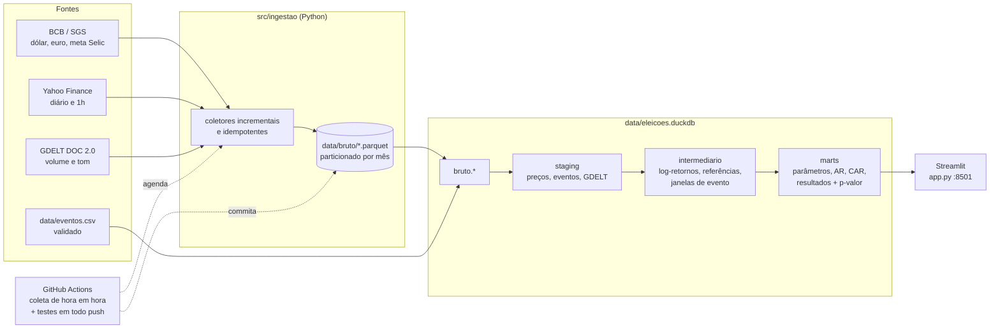

# Eleições 2026 × mercado brasileiro — estudo de evento

> Engenharia + análise de dados que mede **como o mercado brasileiro reage a eventos das
> eleições de 2026**. O projeto é neutro: mede a reação de preços, não avalia candidatos, e
> aplica a mesma metodologia a todos os eventos e a mesma consulta de notícias a cada candidato.
>
> ⚠️ **Não é recomendação de investimento.**

## Pergunta

Os preços de ativos brasileiros (Ibovespa, ações de grande peso e o real) apresentam
**retornos anormais** estatisticamente significativos em torno de eventos eleitorais
— como a divulgação dos resultados do 1º e do 2º turno — depois de descontado o que
seria esperado pelo comportamento do mercado (ou, no caso do real, de outras moedas
emergentes no mesmo período)?

## Arquitetura



As transformações `staging → intermediario → marts` são modelos **dbt-duckdb** (SQL + um
modelo Python para o p-valor). Os Parquet versionados no git são a fonte da verdade; o
DuckDB é reconstruído a partir deles a cada execução.

## Fontes

| Fonte | O quê | Frequência | Observações |
|---|---|---|---|
| [BCB / SGS](https://dadosabertos.bcb.gov.br/) | Dólar venda (série 1), euro venda (21619), meta Selic (432) | diária | códigos confirmados no catálogo de dados abertos do BCB |
| [Yahoo Finance](https://finance.yahoo.com/) via `yfinance` | `^BVSP`, `PETR4.SA`, `VALE3.SA`, `ITUB4.SA`, `BBAS3.SA`, `BRL=X` e controles `MXN=X`, `CLP=X`, `COP=X`, `ZAR=X` | diária e 1h | horários em UTC; ações diárias ajustadas por proventos |
| [GDELT DOC 2.0](https://blog.gdeltproject.org/gdelt-doc-2-0-api-debuts/) | nº de artigos e tom médio por dia | diária | mesma consulta-base para cada candidato do 2º turno |
| `data/eventos.csv` | eventos com data/hora, tipo, descrição e fonte | — | só eventos com data certa e verificável |

Período: desde 01/01/2026, coleta incremental (cada execução só baixa o que falta, com uma
pequena sobreposição para corrigir barras parciais).

## Metodologia

**Estudo de evento** clássico (MacKinlay, 1997), em duas frequências:

| | Diária | Horária |
|---|---|---|
| Retorno | log-retorno fechamento a fechamento | log-retorno barra a barra (1h) |
| Dia/barra 0 | 1º pregão na data do evento; se o evento é a partir das 17h (Brasília) ou fora de pregão, o pregão seguinte | 1ª barra que começa no instante do evento ou depois |
| Janela do evento | **[-1, +3] pregões** | **[-2h, +6h]** (barras -2…+5) |
| Janela de estimação | [-120, -11] pregões (mín. 60) | [-300, -11] barras (mín. 150) |

**Retorno normal / anormal (AR)**

- **Ações** (PETR4, VALE3, ITUB4, BBAS3): modelo de mercado `R = α + β·R_Ibov + ε`, estimado
  por MQO na janela de estimação; `AR = R − (α̂ + β̂·R_Ibov)`.
- **Ibovespa:** modelo de média constante (`AR = R − média`), porque não há na amostra um
  índice de mercado mais amplo contra o qual regredi-lo.
- **Real** (`BRL=X` e o dólar do BCB): `AR = R_BRL − média(R_MXN, R_CLP, R_COP, R_ZAR)`, ou seja,
  quanto o real se moveu além do que outras moedas emergentes se moveram no mesmo dia/hora.
- Observações da janela de estimação que caem na janela de **outro** evento são descartadas.

**CAR e significância:** `CAR = Σ AR` na janela; `t = CAR / (σ̂·√L)`, com σ̂ estimado na janela
de estimação e L o nº de retornos na janela; p-valor bicaudal pela t de Student com os graus
de liberdade da estimação. A validade do procedimento é testada com dados sintéticos com um
choque conhecido injetado (`tests/test_dbt_integracao.py`).

## Resultados

Execução de 23/10/2026, com dados de 01/01 a 22/10/2026. Só o **1º turno** (evento #1,
04/10/2026 17h; dia 0 = segunda, 05/10) tem janela completa. O **2º turno** (25/10) aparece
como `aguardando_dados` e será calculado sozinho quando a coleta automática trouxer os pregões
de 26/10 em diante. Os números atualizados estão no dashboard (`marts.resultados_eventos`).

**Janela diária [-1,+3] pregões (02/10 a 08/10)**

| Ativo | Modelo | CAR | Erro-padrão | t | p-valor | |
|---|---|---:|---:|---:|---:|:-:|
| Ibovespa | média constante | +10,50% | 2,31 p.p. | 4,32 | <0,0001 | *** |
| Vale ON | mercado (β=0,91) | −11,69% | 3,32 p.p. | −3,74 | 0,0003 | *** |
| Banco do Brasil ON | mercado (β=1,30) | −7,42% | 2,78 p.p. | −2,77 | 0,0066 | *** |
| Petrobras PN | mercado (β=0,33) | +7,40% | 4,04 p.p. | 1,76 | 0,0805 | * |
| Itaú Unibanco PN | mercado (β=1,15) | −0,03% | 1,96 p.p. | −0,01 | 0,9886 | n.s. |
| Real — USD/BRL (Yahoo) | BRL − controles | −2,82% | 1,37 p.p. | −2,09 | 0,0392 | ** |
| Real — USD/BRL (BCB) | BRL − controles | −2,66% | 1,30 p.p. | −2,08 | 0,0401 | ** |

**Janela horária [-2h,+6h] (sexta 15h–16h e segunda 10h–15h, horário de Brasília)**

| Ativo | CAR | t | p-valor | |
|---|---:|---:|---:|:-:|
| Ibovespa | +9,96% | 7,39 | <0,0001 | *** |
| Vale ON | −6,93% | −5,04 | <0,0001 | *** |
| Petrobras PN | +2,66% | 1,32 | 0,187 | n.s. |
| Itaú Unibanco PN | +0,62% | 0,65 | 0,519 | n.s. |
| Banco do Brasil ON | +0,05% | 0,04 | 0,969 | n.s. |
| Real — USD/BRL (Yahoo) | −4,19% | −9,18 | <0,0001 | *** (janela parcial, 7 de 8 barras) |

*** p<0,01 · ** p<0,05 · * p<0,10 · n.s. não significativo.

**Leitura (descritiva, não causal):**

- No pregão seguinte ao 1º turno, o Ibovespa subiu cerca de 7,4% em um dia (8,1% só na
  primeira hora). Isso está muito fora da variação típica do período, e as frequências diária e
  horária concordam.
- O real se valorizou: o USD/BRL caiu cerca de 4,5% em 05/10. Descontado o movimento médio de
  MXN, CLP, COP e ZAR, sobra um retorno anormal de −2,7% a −2,8% na janela diária. O resultado
  é o mesmo com o dólar do Yahoo e com o do BCB.
- Nas ações, o retorno anormal mede o desempenho **relativo ao Ibovespa**. Vale e Banco do
  Brasil subiram bem menos do que o modelo de mercado previa para um dia de alta forte do
  índice. Petrobras ficou acima do previsto, com significância só marginal. Itaú acompanhou o
  índice.
- Parte do CAR do Ibovespa (+2,6%) ocorreu na sexta, 02/10, **antes** do evento. Pode refletir
  antecipação (pesquisas de véspera, por exemplo) ou outros fatores; o desenho do estudo não
  separa essas explicações.

## Limitações

- **Poucos eventos.** Com dois eventos (1º e 2º turno), não há poder estatístico para
  generalizações; cada resultado é um estudo de caso.
- **Eventos sobrepostos.** Notícias, pesquisas e choques globais (juros nos EUA, commodities)
  acontecem nos mesmos dias. O controle por moedas emergentes e pelo Ibovespa reduz, mas não
  elimina, essa contaminação; a janela de 5 pregões é longa o bastante para pegar outros fatos.
- **Correlação não é causalidade.** Um CAR significativo diz que o preço se moveu de forma
  incomum em torno do evento, não que o evento causou o movimento.
- **Eventos de fim de semana.** As eleições são aos domingos às 17h; a reação aparece no
  pregão seguinte e mistura tudo o que aconteceu no intervalo.
- **Dados.** Barras horárias do Yahoo podem ter lacunas (sobretudo moedas fora do horário
  comercial) e não são ajustadas por proventos; o GDELT só pesquisa ~3 meses para trás, e o
  volume de notícias não é comparável em nível entre nomes diferentes.
- **Inferência simplificada.** A variância do CAR ignora o erro de estimação dos parâmetros
  e supõe ARs independentes e homocedásticos.

## Como rodar

### Localmente (Python 3.12)

```bash
python -m venv .venv && source .venv/bin/activate   # Windows: .venv\Scripts\activate
pip install -r requirements-dev.txt

pytest -q                          # testes (sem rede, respostas mockadas)
python -m src.pipeline             # coleta incremental + carga no DuckDB + dbt build
python -m src.pipeline --sem-coleta  # só reprocessa os Parquet já existentes
streamlit run app.py               # dashboard em http://localhost:8501
```

Comandos avulsos: `python -m src.ingestao` (só coleta), `python -m src.eventos.validacao`
(valida `data/eventos.csv`), `dbt build --project-dir dbt --profiles-dir dbt` (só dbt).

### Com Docker

```bash
docker compose --profile pipeline run --rm pipeline   # coleta + carga + dbt
docker compose up app                                 # dashboard em http://localhost:8501
docker compose --profile testes run --rm testes       # testes
```

### Adicionando eventos

Edite `data/eventos.csv` (`data_hora` em ISO 8601 **com fuso**, ex. `2026-10-25T17:00:00-03:00`;
`tipo` ∈ debate, pesquisa, resultado, declaracao, outro; `descricao`; `fonte_url`). Inclua só
eventos com data e hora verificáveis e a URL da fonte. Valide com `python -m src.eventos.validacao`.

### Subindo no GitHub (para a coleta automática funcionar)

1. Crie um repositório vazio no GitHub (sem README) e envie o código:
   ```bash
   git remote add origin https://github.com/<seu-usuario>/eleicoes-mercado.git
   git push -u origin main
   ```
   ou, com a CLI: `gh repo create eleicoes-mercado --public --source . --push`.
2. Em **Settings → Actions → General → Workflow permissions**, marque **Read and write
   permissions** (o workflow já declara `permissions: contents: write`, mas algumas contas e
   organizações restringem o padrão).
3. Em **Actions**, habilite os workflows se solicitado e rode **Coleta de dados → Run workflow**
   uma vez para testar (`workflow_dispatch`).
4. A partir daí, `.github/workflows/coleta.yml` roda de hora em hora nos dias úteis durante o
   pregão (13h05–21h05 UTC = 10h05–18h05 em Brasília) e uma vez à noite (01h30 UTC = 22h30),
   e commita os Parquet novos em `data/bruto/`. O `testes.yml` roda pytest e o pipeline
   (carga + dbt build) em todo push.

Observações: o GitHub pode atrasar execuções agendadas nos horários de pico e desativa
agendamentos em repositórios públicos depois de 60 dias sem atividade. Se a coleta parar,
reative o workflow em **Actions**. Commits feitos com o `GITHUB_TOKEN` não disparam outros
workflows, então a coleta automática não aciona o workflow de testes a cada hora.

## Estrutura

```
├── app.py                     # dashboard Streamlit
├── data/
│   ├── bruto/<fonte>/AAAA-MM.parquet
│   └── eventos.csv
├── dbt/                       # projeto dbt-duckdb (staging → intermediario → marts)
├── src/
│   ├── config.py
│   ├── ingestao/              # bcb.py, yahoo.py, gdelt.py, armazenamento.py, carga.py
│   ├── eventos/validacao.py
│   └── pipeline.py
├── tests/                     # pytest (mocks + integração dbt com dados sintéticos)
├── .github/workflows/         # coleta.yml, testes.yml
├── DECISOES.md                # decisões de projeto
└── Dockerfile, docker-compose.yml
```
